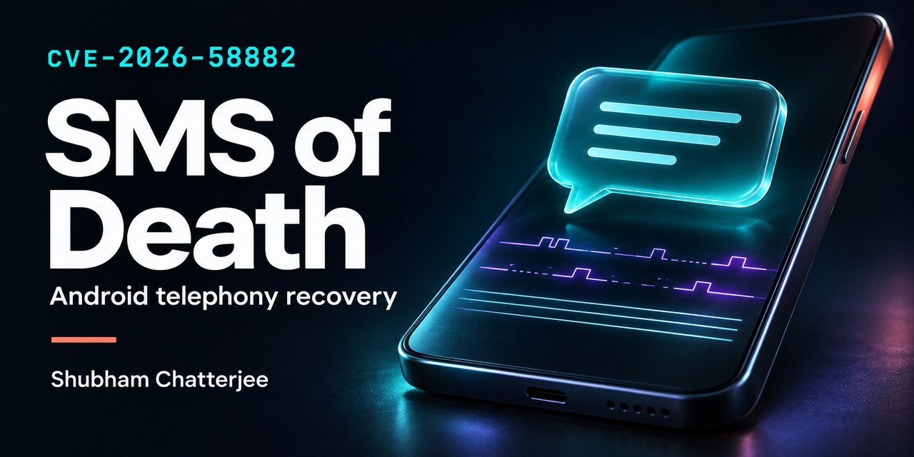
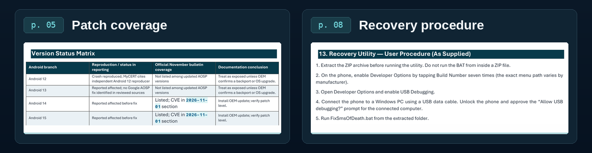

# Android telephony recovery for CVE-2026-58882

A call can drop before a message ever appears in the inbox. Android’s “SMS of Death” vulnerability can interrupt the phone service while it processes an incoming message. This repository contains my research report and a Windows utility for last-resort recovery.

**[Read the research report (PDF)](research-report.pdf)** · **[Open the Windows recovery guide](README.txt)** · **[Inspect the script](FixSmsOfDeath.bat)**

> [!CAUTION]
> **The recovery utility can erase your SMS and MMS.** It clears the Android telephony provider’s data for user 0. Check that your message backup has completed before considering a reset. The script makes no backup. You can read the entire report and check your patch level without running the utility.

## What should I do with my phone?

| What you see | What to do |
| --- | --- |
| Calls and messages work normally | Install the latest security update available for your model. Leave the recovery script alone. |
| You want to check the fix | Open **Settings → About phone → Android version** and find **Android security update**. Google lists this CVE at the **1 November 2026** patch level. For an earlier date or an older Android branch, check whether your manufacturer backported the fix for your exact build. |
| Calls or mobile service keep dropping | Record the model, Android security update date and when the problem started. Dropped calls have several possible causes. Ask your manufacturer or support technician whether they can preserve your messages through recovery. |
| Service is still unusable and you are considering a reset | First verify a completed backup that includes your messages. If the handset holds evidence or you need messages that you cannot back up, stop here and seek qualified support. |

[Google’s November 2026 Android Security Bulletin](https://source.android.com/docs/security/bulletin/2026/2026-11-01) · [Find the Android security update date](https://support.google.com/android/answer/7680439) · [Check Android backup details](https://support.google.com/android/answer/2819582)

## What the Windows utility does

1. **Finds Android Debug Bridge (ADB).** It uses ADB from your Windows PATH when available. Otherwise it downloads Google’s Windows SDK Platform-Tools to the current user’s local Android SDK folder.
2. **Shows the target phone.** It requires one authorised device and displays its serial number. Check the serial before continuing. Disconnect any other phones or emulators.
3. **Waits for an explicit choice.** Typing uppercase `YES` authorises clearing the telephony provider for Android user 0. Press Enter at the empty prompt to cancel. Expect stored SMS and MMS to be lost. Effects on call history and settings vary by device.
4. **Leaves verification to you.** After a completed reset, restart the phone manually and check signal, an ordinary call and a text. If service still fails, contact support before attempting another reset. The manufacturer’s security update supplies the underlying fix.

The script was reviewed as text. Recovery on a physical handset and backup restoration remain unverified. [Step-by-step instructions and troubleshooting](README.txt)

## Inside the report

[](research-report.pdf)

| Pages | What you’ll find |
| --- | --- |
| 2–4 | The findings, observed phone-service symptoms and limits of the evidence. |
| 5–6 | Android version coverage, the disclosure timeline and Google’s published fix. |
| 7–9 | Recovery options, message backup, the script review and troubleshooting. |
| 10–11 | Original file hashes, references and notes about this public edition. |

## Author and file integrity

**Shubham Chatterjee** · B.Sc. Cybersecurity, Indian School of Ethical Hacking (ISOEH), Kolkata. I prepared the report and the Windows recovery utility. My thanks to **Mr. Saumitra Biswas**, Senior Faculty at ISOEH, for guiding this research. The original vulnerability disclosure is credited to **Mark Blaszczyk**.

The 13 November 2026 report reviews the original utility. For this public edition, the script and guide use Google’s November patch baseline, make the data-loss warning explicit and identify what to check after reboot. The reset command now uses the serial number shown at confirmation. Appendix A preserves the original file hashes. The current hashes are in [SHA256SUMS](SHA256SUMS).

To check the script on Windows, open PowerShell in the extracted repository folder and compare the result with its entry in `SHA256SUMS`.

```powershell
Get-FileHash .\FixSmsOfDeath.bat -Algorithm SHA256
```
